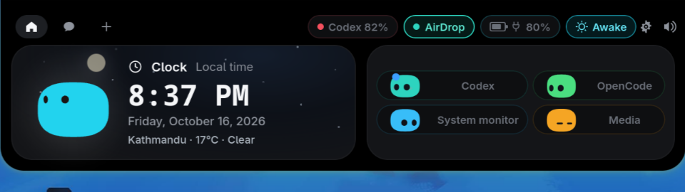
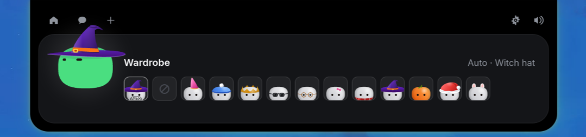

# Mochi

Mochi is a Linux-first, Dynamic Island-style desktop companion built with Tauri, Rust, and TypeScript. Its compact top-edge capsule brings OpenCode and coding-agent activity, MPRIS media controls, battery status, time, and weather together without taking over your desktop. On supported MediaTek MT7922 hardware, an experimental AirDrop/AWDL receiver can accept iPhone transfers with explicit consent. The repository also contains Windows and Apple-platform source.


*Live capture from the Linux app. [Watch the short MP4 demo](docs/media/mochi-demo.mp4). The main setup path below builds Mochi locally; this repository also contains Windows and Apple-platform source.*

## What Mochi does

- **Agent activity and chat:** follow supported coding-agent sessions, respond to prompts, and chat through your existing OpenCode installation. Setup installs the OpenCode hook and starts its local service; it does not install Llama.
- **Media:** play, pause, skip, and select players exposed through Linux MPRIS. A browser or page must publish a controllable media session for these buttons to work.
- **System and power:** view process and network snapshots, see battery charge and charging state, and use the optional Awake control to inhibit screen-idle blanking on supported Linux desktops.
- **AirDrop (Linux, experimental):** control an optional AWDL receiver and select a specific nearby recipient for file sharing. Hardware support varies; a real iPhone transfer is required to verify it on your machine. On the development machine, receiving from an iPhone has been tested; sending to an iPhone has not. See [AirDrop setup](#airdrop-style-sharing-on-linux).
- **Clock and weather:** show local 12-hour time and, if you opt in, live conditions and subtle weather animation behind the Clock card.
- **A little personality:** Mochi reacts to music, charging changes, low battery, and the time of day. Reminders and animations stay inside the expanded capsule.

The four small companion pills are configurable in Settings. The capsule retracts after inactivity and reopens from the top-edge hover area.

### Screenshots and video

| Overview | Wardrobe |
| --- | --- |
|  |  |

*These are captures from a running Linux session. Other platforms and desktop themes may look different.*


[Watch the Linux demo video (MP4)](docs/media/mochi-demo.mp4) · [View the overview screenshot](docs/media/mochi-overview.png) · [View the wardrobe screenshot](docs/media/mochi-wardrobe.png). These captures show the general interface, **not** a verified AirDrop transfer or its progress ring.

## Install on Linux

The setup script supports Arch-family, Debian/Ubuntu-family, Fedora-family, and openSUSE-family desktops with the required WebKitGTK 4.1 packages. It targets x86_64 and aarch64; immutable/OSTree hosts and distributions without the required packages need a manual setup. Run it as your desktop user, not with `sudo`. It asks for `sudo` when system packages or MT7922 radio helpers need installing. On a supported MT7922, setup also installs the pinned AirDrop backend in the same run; use `--no-airdrop` to opt out.

```bash
git clone https://github.com/Spydomain/Mochi.git
cd Mochi
./mochi-full-setup.sh --check   # inspect dependencies without changing anything
./mochi-full-setup.sh           # install, build, configure, and launch
```

Setup installs the required distro packages, Node.js 24 LTS locally if the existing Node is unsuitable, Rust, OpenCode v2 if needed, the app, and its hook. It runs the frontend tests before installing the release build. The first run downloads dependencies and can take several minutes. Review the script and its upstream installers before running it.

On Niri, setup enables a user `systemd` service for graphical login. On other desktops it writes an XDG autostart entry. It also configures a daily timer—or a login-time fallback without user `systemd`—to remove **Mochi chat sessions** older than 30 days without deleting other OpenCode work. Setup keeps your local Git checkout and existing preferences, while setting autostart, hover opening, English, and OpenCode as its defaults. It does not reset or pull the repository. Use `./mochi-full-setup.sh --no-launch` if you want to install without starting the app immediately.

### Update

```bash
./update-mochi.sh
```

The updater checks this repository's default branch. It leaves an up-to-date, complete installation unchanged, fast-forwards a clean checkout when a new commit exists, and rebuilds through the same setup script. If a previous installation stopped partway through or its relay, cleanup script, AirDrop consent hook, or supported MT7922 backend is missing or outdated, it retries setup. It refuses to overwrite local edits or merge divergent histories; commit or stash your changes first.

### Check the running app

```bash
systemctl --user status mochi-app.service
journalctl --user -u mochi-app.service -n 100 --no-pager
opencode service status
```

On non-Niri desktops, check `~/.config/autostart/mochi.desktop` instead of the Mochi service. Settings live at `~/.config/mochi/settings.json`, local logs at `~/.local/share/mochi/mochi.log`, and installed binaries under `~/.local/share/mochi/bin/`.

## Weather and location

Weather is optional. **Find city** saves the city you choose. **Locate me** requests a fresh device fix on every app start and daily while Mochi runs; if location services are late after login, it retries after 2 minutes and then 10 minutes later. Mochi accepts only fixes reported within 5 km. A coarse GeoClue/IP-level result is not presented as your exact city: your last saved city remains in use until a better fix arrives. If your device cannot provide one, use Find city.

With live weather enabled, Mochi sends the selected coordinates to Open-Meteo for a forecast at most every 15 minutes. An accepted device fix is sent to OpenStreetMap Nominatim to obtain a city name; if naming fails, its coordinates can still provide weather. Older IP-only preferences remain separate and use ipwho.is. Offline night-sky animation uses local time without a weather request.

## AirDrop-style sharing on Linux

Mochi's **AirDrop** switch beside Codex controls an AWDL/AirDrop backend, not ordinary Bluetooth file transfer. Setup installs the tested MT7922 route on matching hardware; other Wi-Fi adapters need a separately configured backend. When the backend reports itself visible, your Linux computer may appear under **Other Devices** in the iPhone's **Share → AirDrop** picker. Received files go to `~/Downloads` by default. You do **not** need to install an iPhone app. Turn the switch off after use.

### MT7922 / CachyOS: built-in radio route

MediaTek MT7922 adapters (`14c3:0616`, `mt7921e`) can use the experimental [airdrop-mt7921](https://github.com/jedbillyb/airdrop-mt7921) P2P-GO backend. Mochi selects it when the local daemon is installed. This route also needs a running systemd user manager (`systemd-run --user`) to keep the receiver independent of the Mochi window. Mochi requires an existing **5 GHz** Wi-Fi association and requests shared P2P-GO mode; it does not deliberately switch networks. The backend may temporarily stop Avahi/mDNS while active. Upstream reports that this mode adds latency and can still stall the MT7922 driver, so **it cannot guarantee uninterrupted Wi-Fi**. Avoid using it for critical network activity.

On a detected MT7922 (`14c3:0616`, `mt7921e`), `./mochi-full-setup.sh` and updates through `./update-mochi.sh` install the pinned [airdrop-mt7921](https://github.com/jedbillyb/airdrop-mt7921) and [OWL](https://github.com/jedbillyb/owl) revisions with Mochi's tested patches, a checksum-verified hostapd 2.11 build with the [P2P-GO patch](https://github.com/jedbillyb/mt7921-dual-channel), and root-owned helpers. The upstream installer adds narrowly scoped passwordless-sudo rules after validating them with `visudo`; you may be prompted for your administrator password on a fresh machine. Only root-owned binaries outside the writable source checkouts enter these rules. Installation never starts the radio, refuses to modify an active receiver, and creates a **shared-mode** config instead of upstream's Wi-Fi-disconnecting exclusive default. `--no-airdrop` skips radio provisioning. Review the upstream [P2P-GO instructions](https://github.com/jedbillyb/airdrop-mt7921/blob/main/daemon/README.md) before enabling this experimental feature.

Setup also applies the Wi-Fi coexistence update. This keeps the managed Wi-Fi station awake while AirDrop shares the radio and restores its previous power-saving setting when AirDrop stops. The connection stays on its existing network; power use may increase while AirDrop is active. An unrecognized backend checkout is preserved for manual review rather than overwritten.

The backend lives under `~/.local/share/mochi/airdrop-mt7921`. To send **to** Mochi, set the iPhone to **Everyone for 10 Minutes** and **open** its Share → AirDrop sheet; the AirDrop switch only confirms that the Linux radio is running, not that the iPhone has discovered it. To send **from** Mochi, keep the iPhone unlocked and in receiving mode, **close** its share sheet, click **Find iPhone**, and select the named phone before choosing files. On MT7922, Mochi briefly sends a Bluetooth wake advertisement before scanning AWDL. This requires the backend's `tools/blewake-dbus.py`, BlueZ, and Python D-Bus bindings. Mochi passes the selected device's unique service ID to the sender; it will not silently choose the first nearby device. Discovery may take about 30 seconds and needs a fresh scan before sending.

On the MT7922 route, an incoming transfer opens a full-island **Accept / Decline** prompt showing the sender and item. Mochi accepts only an explicit click; if the app is unavailable or nobody answers within 15 seconds, the backend declines. After acceptance, the compact island shows a transfer ring for as long as the upload is running; it shows a check only for a fully extracted file and an exclamation mark for an incomplete one. The receiver runs as a separate systemd user service, so closing or restarting the Mochi UI does not stop an opted-in radio session; use **Turn off** to stop it. Logout still ends the user service. Open **Settings → AirDrop (Linux)** to set the advertised device name and an existing, user-owned absolute folder for received files. Leave the folder field empty for `~/Downloads`. Turn AirDrop off and on to apply changes. The optional Omdrop/USB route uses its own receiver and consent flow; the custom name and folder controls currently apply only to MT7922.

When the receiver supplies both a declared total and a matching growing archive, the compact ring fills from **measured upload bytes**, refreshed during the transfer. Without a reliable total or matching file it remains indeterminate; the ring reaches completion only after the receiver verifies extraction. This progress display has automated coverage but still needs a fresh, observed iPhone transfer to confirm the on-screen behavior.

### Other Linux Wi-Fi adapters (Omdrop)

To send files **from Mochi to an iPhone**, set AirDrop on the phone to **Everyone for 10 Minutes**, keep it unlocked, and **close its Share → AirDrop sheet** (that sheet puts the phone in sending mode). Click **Find iPhone** in Mochi, then **Send** beside the right phone. Omdrop opens the desktop's multi-file chooser. The recipient accepts the transfer on the phone. Mochi reports completion only after Omdrop exits successfully. Do not send to an unnamed device unless you recognize it.

This is optional software requiring administrator privileges and supported Wi‑Fi hardware; Mochi deliberately does not install or run its radio helper as root. On Arch/CachyOS, install the backend from the [omdrop-owl AUR package](https://aur.archlinux.org/packages/omdrop-owl) after reviewing it, and install Omdrop's receiver dependency:

```bash
yay -S omdrop-owl                  # or build/review its AUR package with makepkg
sudo pacman -S --needed python-libarchive-c keyutils python-gobject  # chooser uses PyGObject + desktop portal
mkdir -p "$HOME/.local/share/mochi"
git clone https://github.com/netmojo-systems/omdrop-plugin.git "$HOME/.local/share/mochi/omdrop-plugin"
"$HOME/.local/share/mochi/omdrop-plugin/bin/omdrop" setup  # user-level receiver/service and identity
~/.local/bin/omdrop doctor         # check missing packages, backend or firewall
~/.local/bin/omdrop name Mochi     # optional: name shown in the iPhone picker
```

On other distributions follow [omdrop-owl's package instructions](https://github.com/t4t5/omdrop-owl#install) and [Omdrop's non-Omarchy CLI instructions](https://github.com/netmojo-systems/omdrop-plugin#on-other-linux-systems). If UFW is active, follow Omdrop's `omdrop firewall install` instructions to allow its receiver only on `awdl0` (TCP 8771). Omdrop's *Everyone* mode accepts files from nearby senders; turn the switch off when done or configure [Contacts Only](https://github.com/netmojo-systems/omdrop-plugin#contacts-only) if desired.

For hardware other than the MT7922 route above, [omdrop-owl's supported-adapter table](https://github.com/t4t5/omdrop-owl#supported-hardware) applies. A separate supported USB adapter, for example the tested MT7612U, keeps the internal card free for networking. Point Omdrop at the USB adapter's interface (`iw dev` lists it):

```bash
sudo mkdir -p /etc/omdrop
printf '%s\n' USB_INTERFACE_NAME | sudo tee /etc/omdrop/infra-iface
~/.local/bin/omdrop doctor
```

The USB card's *exclusive* mode takes **that USB card** out of normal networking; it should not take the internal Wi-Fi offline. Mochi refuses to start Omdrop on its selected adapter if that adapter is connected to Wi-Fi, even if the driver advertises shared mode. Check the backend's card-specific notes and test it with a nearby iPhone before relying on it. The switch shows Omdrop's actual receiver/radio status and a setup or error message if it cannot make the computer visible. Neither a green switch nor unit tests replace a real transfer test: on the development machine, iPhone → Mochi received a photo successfully, but Mochi → iPhone discovery and transfer remain unverified.

The MT7922 route above is still not a no-disconnection guarantee: upstream reports that a sustained active AWDL session can stall the driver and require recovery. [AirScreen](https://www.airscreen.app/) is an AirPlay/Cast receiver, not an AirDrop file receiver; it does not make Linux appear in the iPhone AirDrop picker.

The device list is passive by default. **Find iPhone** actively scans for AirDrop services and may briefly advertise over Bluetooth to wake nearby devices; use it only when you want to discover them. An empty list means no iPhone AirDrop service answered, even if AWDL radio frames were seen. If the iPhone does not list Mochi, confirm Bluetooth and Wi-Fi are enabled on the phone, reopen its Share → AirDrop sheet, and allow a few seconds; shared-radio mode remains experimental and may not establish a usable channel on every run.

The third-party receiver and sender keep local runtime logs that may include device names and filenames. Review them before sharing diagnostics. Mochi does not add a cloud relay to this optional path.

## Media and troubleshooting

Linux media controls use the player's MPRIS interface. Mochi sends previous/next commands even when a player reports stale capability flags, but the player or page may still ignore them. To see what your desktop exposes:

```bash
playerctl -l
playerctl metadata
```

| Symptom | First check |
| --- | --- |
| The capsule does not reopen | Move the pointer to the top-center edge; then inspect the app service or local log. |
| Media controls do nothing | Start eligible media and confirm the browser or app appears in `playerctl -l`. |
| Locate me names no new city | Check desktop location permission and GeoClue accuracy; use Find city if the only fix is coarse. |
| Chat reports a local connection error | Check `opencode service status`, then try `opencode service start`. |
| Awake is off but the laptop has not suspended | Awake off releases Mochi's idle inhibitor; your desktop's screen-off and suspend timeouts still apply. Check those timeouts and other apps' inhibitors before reporting a regression. |

## Report a bug

Report reproducible bugs through [GitHub Issues](https://github.com/Spydomain/Mochi/issues) or email [contactme@bikashkumarsarraf.com.np](mailto:contactme@bikashkumarsarraf.com.np). Include your OS/desktop, Mochi version or commit, what you expected, what happened, and steps to reproduce. A screenshot or short video helps when the issue is visual. For AirDrop, include the adapter model, whether the receiver was on, and whether Wi-Fi stayed connected; note that iPhone → Mochi partial uploads and Mochi → iPhone discovery are not yet guaranteed to work on every device. **Redact** sender names, filenames, tokens, chat text, and other private details before attaching logs or captures.

## Privacy and scope

Mochi's Linux agent hook uses a private same-user Unix socket, not a public Internet listener. Its settings and logs are local, but they may contain session names or other sensitive context. OpenCode uses your configured agent, model provider, plugins, and permissions; a prompt asking it not to use tools is not a security boundary. Optional integrations and live weather contact their respective services only when enabled. Review those services before using Mochi with sensitive work.

The Linux installer is the supported path documented here. The shared Tauri client has a separate [Windows/development guide](windows/README.md); the repository also contains macOS/iOS source and an [optional Apple Live Activity relay](relay/README.md). This README does not claim that prebuilt packages are published for every platform.

## Development

```bash
cd windows
npm ci
npm test
npm run build
cargo test --manifest-path src-tauri/Cargo.toml --lib
```

**Mochi is a modified version of [Coucou](https://github.com/Louis-CFM/coucou). Special thanks to [Louis-CFM](https://github.com/Louis-CFM) and the Coucou project for the original foundation.**

Questions and bug reports: [contactme@bikashkumarsarraf.com.np](mailto:contactme@bikashkumarsarraf.com.np).
