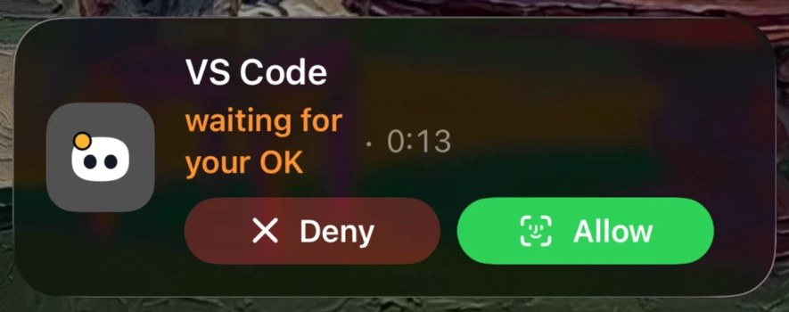

# Mochi iPhone Live Activity relay

This Cloudflare Worker forwards Mochi activity from the macOS app to Apple Push Notification service (APNs), so a paired iPhone can show the activity in the Dynamic Island and on the Lock Screen while the Mac is locked. The APNs signing key stays in Worker secrets; it must never be packaged with a desktop or phone app.

[Project overview](../README.md) · [Desktop development](../windows/README.md) · [Linux AirDrop](../windows/airdrop/README.md)

This is an optional Apple-platform component, **not an AirDrop service or a prerequisite for Linux/Windows setup**. No Apple push delivery was tested during the latest Linux screenshot session.



*Earlier Apple-platform example, not a capture from the latest Linux build. For the October 18, 2026 desktop captures, see the [Linux GIF](../docs/media/mochi-demo.gif) or [27-second video](../docs/media/mochi-demo.mp4). Those recordings show the local Linux interface and an AirDrop receive, not Apple push delivery or this relay.*

```text
Mac app ── activity state + iPhone push token ──▶ your Cloudflare Worker ──▶ APNs ──▶ iPhone
```

## Before you deploy

You need an Apple Developer team with APNs access, an iOS app configured for Live Activities and push notifications, a Cloudflare account, and Node.js/npm. The `APNS_TOPIC` must match your iOS app's bundle identifier followed by `.push-type.liveactivity`. The repository's `wrangler.toml` contains project-specific example team/topic values; replace them with values for **your** Apple Developer team and iOS build.

The macOS source currently has a default relay URL pointing to an existing deployment. If you deploy your own Worker, set the Mac app's `phoneRelayURL` preference to **your** URL before enabling the feature. This avoids sending activity tokens and state to that default deployment.

| Configuration | Storage | Purpose |
| --- | --- | --- |
| `APNS_TEAM_ID` | `wrangler.toml` | Your Apple Developer Team ID. |
| `APNS_TOPIC` | `wrangler.toml` | Your iOS bundle identifier plus `.push-type.liveactivity`. |
| `APNS_KEY_ID` | Worker secret | Identifier of your APNs signing key. |
| `APNS_KEY` | Worker secret | Complete private `.p8` key in PEM format. |
| `phoneRelayURL` | Mac app preference | Your deployed Worker URL. |

Use a self-hosted deployment you control. The bundled configuration is an example, not a shared service entitlement or a safe production default.

## Deploy your Worker

1. In Apple Developer, create an APNs signing key and download its `AuthKey_*.p8` file. Save its Key ID and your Team ID. Treat the key file as a secret; Apple may allow only one download.
2. Edit `relay/wrangler.toml`: set `APNS_TEAM_ID` and `APNS_TOPIC` for your Apple account and app. Do not put the private key in this file.
3. From the `relay` directory, install dependencies and add the two Worker secrets:

   ```bash
   npm ci
   npx wrangler login
   npx wrangler secret put APNS_KEY_ID
   npx wrangler secret put APNS_KEY < /secure/path/AuthKey_XXXXXXXXXX.p8
   npm run typecheck
   npm run deploy
   ```

   At the `APNS_KEY_ID` prompt, enter the Key ID. Replace the example file path with the downloaded key file's actual path; input redirection sends the entire PEM file to Wrangler without putting its contents in shell history or a command argument. Keep the file private.

4. Verify the deployment URL printed by Wrangler:

   ```bash
   curl https://YOUR-WORKER.YOUR-SUBDOMAIN.workers.dev/
   ```

   A healthy Worker replies `Mochi relay`. This only checks the route; a real Live Activity additionally requires working Apple credentials, entitlements, a valid phone token, and a paired Mac/iPhone.

5. On the Mac, point Mochi at your deployed Worker, then restart the Mac app:

   ```bash
   defaults write fr.louisraille.NotchBuddy phoneRelayURL "https://YOUR-WORKER.YOUR-SUBDOMAIN.workers.dev"
   ```

   The preference domain above comes from the current macOS source. If you change the app's bundle identifier, use its new preference domain. Enable the iPhone Live Activity integration in the Mac app after configuring the URL.

## Request contract

The Mac app posts `POST /v1/live-activity` with an iPhone Live Activity push token, APNs environment (`development` or `production`), event (`start`, `update`, or `end`), and a bounded activity state. That state includes the agent name, visual state, short status text, counters, and optionally a SHA-256 fingerprint for a pending approval. The Worker validates known fields and constructs the APNs payload itself. Caller-supplied agent and status text can appear in alerts; field validation does not authenticate the caller or make that text trustworthy.

The accepted state strings are `pillId`, `agent`, `color`, `state`, `statusText`, and `tone` (at most 60 JavaScript UTF-16 code units each). Counters `stepIndex`, `stepCount`, and `others` must be integers from 0 to 999. Optional state fields include `since` and a 64-character hexadecimal `approval` fingerprint. Optional top-level `urgent` must be a boolean; `dismissAfter` must be an integer from 0 to 14,400 seconds and affects only `end` events.

The entire JSON request body, including unknown fields and whitespace, is limited to 4,096 UTF-8 bytes. The Worker reads the stream into a fixed-size buffer, stops and initiates cancellation on the first chunk that exceeds the limit, and returns `413` before parsing or signing. This works without `Content-Length` and with an understated header. A declared length above the limit is rejected immediately. This size limit does not replace caller authentication or rate limiting.

| Response | Meaning |
| --- | --- |
| `200` | APNs accepted the request. |
| `400` / `413` | Invalid request or body exceeding the actual/declared byte limit. |
| `410` | APNs says the token is no longer valid. |
| `502` | APNs or relay delivery failed; `x-apns-status` is present when an upstream error status was received. |

`GET /` is a simple health response, not an end-to-end push test.

Delivery errors contain only a JSON `reason`: a recognized APNs code (including `BadDeviceToken` and `Unregistered`) or `RelayDeliveryFailed`. Unexpected upstream bodies, extra response fields, signing errors, transport errors, and upstream body-read errors are not echoed. Upstream error bodies also have a 4,096-byte read limit; read failures return `502` even if the upstream status was `410`. Signing or transport failures before an upstream response have no `x-apns-status`.

Provider JWTs are cached in memory for up to 50 minutes and matched against the team ID, key ID, and key material. Concurrent requests with matching cached credentials share the pending signing operation. Failed signing is evicted so the next request can retry; a backward clock jump also forces a fresh token.

## Development and updates

From the `relay` directory:

```bash
npm ci
npm test
npm run typecheck
npm audit
npm run dev
```

`npm test` runs offline Node.js `node:test` regressions. TypeScript is compiled in memory, signing and APNs are mocked, and all inputs are synthetic: no private keys, real device tokens, or network access are needed. Coverage includes streamed body limits and cancellation, validation, sanitized delivery failures, credential-aware caching, and concurrent signing.

The development command starts Wrangler's local Worker server; it does not establish a paired iPhone or configure Apple entitlements. Do not send real device tokens during casual health checks. Use `npx wrangler deploy --dry-run` to compile and validate the current configuration without uploading. After reviewing source and configuration changes, run the tests and type-checking before deploying your own Worker. The Linux `update-mochi.sh` script does not deploy this Worker or rotate its secrets.

## Troubleshooting

| Symptom | Check |
| --- | --- |
| Health route works, but no Live Activity appears | Verify pairing, phone token, entitlements, APNs environment, topic, and Apple credentials. |
| `400` or `413` | Check the request fields and actual UTF-8 body size, including whitespace and unknown fields, as well as the declared length. |
| `410` | Obtain a fresh Live Activity token; the old token is no longer valid. |
| `502` | Inspect the sanitized reason and any `x-apns-status`. `RelayDeliveryFailed` may indicate signing/configuration, transport, or upstream response failures; internal details are deliberately omitted. |
| The Mac still contacts another deployment | Set `phoneRelayURL` in the built app's actual preference domain and restart it. |

## Security and privacy

The Worker code has no database or application logging. Its Wrangler configuration disables Worker observability (`observability.enabled = false`), Wrangler usage metrics (`send_metrics = false`), and automatic dependency instrumentation (`dependencies_instrumentation.enabled = false`). These opt-outs do not prevent Cloudflare and Apple from processing requests or describe all provider-side data handling. Requests include a push token and activity status; treat both as sensitive. The current `POST` route has **no independent caller authentication or rate limiting**. A public deployment should add suitable access control and abuse protection in coordination with the Mac client. Do not publish APNs keys, push tokens, or request bodies in issues or logs. Review Cloudflare and Apple data handling for your deployment.

On October 16, 2026, the dependency audit findings in the `wrangler` → `miniflare` → `sharp` development-tool chain were resolved by updating `relay/package-lock.json` with `npm audit fix`; the subsequent audit reported **0 vulnerabilities**. This is a point-in-time dependency result, not proof of production security. The relay code and regression-test changes do not modify that lockfile.

Report reproducible issues through [GitHub Issues](https://github.com/Spydomain/Mochi/issues) or [contactme@bikashkumarsarraf.com.np](mailto:contactme@bikashkumarsarraf.com.np), with secrets and tokens removed. For licensing, see the project's [MIT License](../LICENSE). For the primary desktop install, return to the [Mochi guide](../README.md).

**Mochi is a modified version of [Coucou](https://github.com/Louis-CFM/coucou). Special thanks to [Louis-CFM](https://github.com/Louis-CFM) and the Coucou project for the original foundation.**
