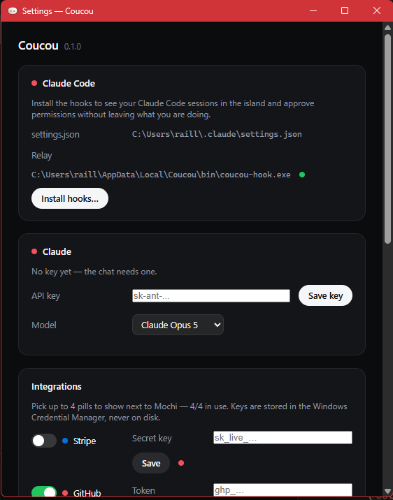

# Mochi desktop client — Windows and development

This directory contains Mochi's shared TypeScript interface and Tauri/Rust desktop application. Linux users should start with the [automated installation guide](../README.md#install-on-linux); the Windows build and contributor workflow are documented here. The directory name is historical: it also contains the Linux desktop implementation.

[Project overview](../README.md) · [Linux AirDrop](airdrop/README.md) · [Optional iPhone relay](../relay/README.md)


*The screenshot shows the shared interface on Linux. Window behavior and available integrations can differ on Windows.*

## Screenshots and video

| Overview | Compact island | Settings |
| --- | --- | --- |
|  |  |  |

These older Windows captures are interface references, not evidence of a newly tested Windows release. The latest Linux captures, recorded October 18, 2026, show [Clock and weather](../docs/media/mochi-overview.png), an actual [incoming iPhone video request](../docs/media/mochi-airdrop-request.png), [transfer progress](../docs/media/mochi-airdrop-progress.png), and verified receipt in the [animated demo](../docs/media/mochi-demo.gif) and [MP4 video](../docs/media/mochi-demo.mp4). The 27-second edit uses real-time excerpts, omits waits, and enlarges compact indicators; it is not a speed benchmark. Linux AirDrop is not a Windows feature.

## Requirements

- Windows 10 or 11 with Microsoft Edge WebView2 Runtime.
- Node.js and npm. Node.js 24.12+ matches the Linux setup's supported 24.x toolchain; the Linux installer also accepts 22.20+.
- Rust and Cargo installed through [rustup](https://rustup.rs/).
- Visual Studio Build Tools with the **Desktop development with C++** workload and a compatible Windows SDK.

Install Git if it is not already available. Run the commands below in PowerShell as your normal user. A source build downloads npm and Cargo dependencies and needs Internet access on its first run.

## Get started

```powershell
git clone https://github.com/Spydomain/Mochi.git
cd Mochi\windows
npm ci
npm run tauri dev
```

`npm run tauri dev` builds the hook and launches the development app. If the Rust toolchain or C++ workload is missing, resolve that prerequisite before retrying.

## Development workflow

| Command | Purpose |
| --- | --- |
| `npm test` | Run the shared interface regression tests. |
| `npm run build` | Prepare the Cargo cache, build the release hook, type-check TypeScript, and build frontend assets. |
| `npm run tauri dev` | Start the complete desktop app with its frontend development server. |
| `npm run dev` | Start only the frontend server; this does not launch the native app. |
| `cargo test --manifest-path src-tauri/Cargo.toml --lib` | Run native library tests for the host platform. |
| `npm run pack` | Build and collect host-platform release packages. |

The frontend development URL is `http://localhost:1420`. A connection-refused page there usually means the development server is not running; the installed release application uses bundled assets and does not depend on that server. OpenCode's local service is a separate integration—check `opencode service status` for chat connection failures.

On Linux, first install native prerequisites through the [main setup script](../README.md#install-on-linux), then run development commands from this directory. Tests on one operating system do not verify platform-specific integrations on another.

## Test and package

From the `windows` directory:

```powershell
npm test
npm run build
cargo test --manifest-path src-tauri/Cargo.toml --lib
npm run pack
```

`npm run pack` builds packages for the host operating system and collects them in `windows/release/`. On Windows it produces NSIS and MSI installers. On Linux it produces AppImage, DEB, and RPM packages, with architecture-specific names such as `Mochi-Linux-0.3.0-x86_64.AppImage`. Tauri's original artifacts remain in `windows/target/release/bundle/`. Inspect the build output for the actual paths; building on Linux does not produce or verify Windows packages.

The Linux desktop packages do not provision OpenCode, agent hooks, login autostart, or the optional privileged AirDrop backend. Use the [full Linux setup](../README.md#install-on-linux) for that configuration. Packages built on a recent distribution also require compatible system libraries; test each intended distribution before publishing. The locally prepared Linux packages are unsigned, and no GitHub release is implied by a successful local build. When distributing them with a `SHA256SUMS` manifest, verify it from the artifact directory with `sha256sum --check SHA256SUMS`.

### After moving or renaming a checkout

Tauri's generated permission metadata can contain absolute build paths. The `predev` and `prebuild` hooks run `scripts/prepare-cargo-target.mjs`, which invalidates the generated `windows/target` cache when the workspace path changes. Run the normal npm/Tauri commands after a move instead of copying an old target cache into a fresh checkout. The next native build may take longer; source files and saved app preferences are not removed by that cache preparation.

## Source layout

| Directory | Contents |
| --- | --- |
| `src/` | Shared interface, companion views, settings, and animations. |
| `src-tauri/` | Native commands and operating-system integration. |
| `scripts/` | Hook preparation, packaging, Linux helpers, and recovery tools. |
| `tests/` | Interface tests with mocked native APIs. |
| `airdrop/` | Optional Linux receiver code, pinned patches, and bundle documentation. |

## Configuration and local data

| Item | Path |
| --- | --- |
| Preferences and custom sounds | `%APPDATA%\Mochi` |
| Preferences file | `%APPDATA%\Mochi\settings.json` |
| Logs, inbox, and helper binaries | `%LOCALAPPDATA%\Mochi` |
| App log | `%LOCALAPPDATA%\Mochi\mochi.log` |

OpenCode and other coding-agent integrations use their own installed binaries and credentials. Mochi does not bundle a model or replace their permission controls. Feature availability varies by operating system: Linux MPRIS, Niri autostart, the experimental Linux AirDrop control, and Linux location-service notes in the [main guide](../README.md) are not Windows setup instructions.

For the optional Apple Live Activity integration, see the separate [relay guide](../relay/README.md); it is not needed to build or use this Windows app.

Found a bug? Open a [GitHub Issue](https://github.com/Spydomain/Mochi/issues) or email [contactme@bikashkumarsarraf.com.np](mailto:contactme@bikashkumarsarraf.com.np). Include the Windows version, app commit, reproduction steps, and a redacted screenshot or video when useful. The Linux AirDrop receiver is not a Windows feature.

## License

Mochi is distributed under the [MIT License](../LICENSE). See the [AirDrop bundle notes](airdrop/README.md) for separate third-party source and patch licensing; that experimental backend is Linux-only.

**Mochi is a modified version of [Coucou](https://github.com/Louis-CFM/coucou). Special thanks to [Louis-CFM](https://github.com/Louis-CFM) and the Coucou project for the original foundation.**
