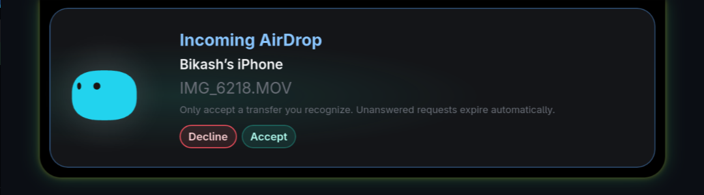

# Mochi AirDrop on Linux

Mochi can control an optional AWDL/AirDrop backend for exchanging files with nearby Apple devices. This guide covers the experimentally supported MediaTek MT7922 receiver, its source bundle, and safe diagnostics. It is not a Windows feature and does not use the optional Apple Live Activity relay.

[Project overview and Linux install](../../README.md) · [Desktop development](../README.md) · [Optional iPhone relay](../../relay/README.md)



*Captured from the running Linux app on October 18, 2026. The video was accepted explicitly, its archive trailer was verified, and the receiver returned HTTP 200. The [27-second desktop recording](../../docs/media/mochi-demo.mp4) uses real-time excerpts with waits omitted and compact indicators enlarged; no transferred-file contents or audio are shown.*

## Support and limitations

| Requirement | Current scope |
| --- | --- |
| Automated radio setup | MT7922 PCI ID `14c3:0616`, driver `mt7921e`. Other adapters are not enabled by this installer. |
| Desktop session | Linux with a running systemd user manager for the independent receiver service. |
| Wi-Fi | An existing 5 GHz association; shared P2P-GO mode keeps that association rather than deliberately disconnecting it. |
| Nearby iPhone | Wi-Fi and Bluetooth enabled; use Everyone for 10 Minutes during testing. |
| Verified direction | iPhone → Mochi, plus a small generated JPEG from Mochi → iPhone on the MT7922 development machine. |
| Performance | Experimental shared-radio behavior; discovery, throughput, and Wi-Fi responsiveness can vary. |

The recorded test received a 76.44 MB video at a receiver-reported average of about 1.01 MB/s. The saved MOV was also readable by `ffprobe`. The receiver logged an incomplete HTTP-ending warning after the verified archive arrived, then saved the file and returned HTTP 200. This is one observed receive, **not a maximum-speed claim, proof of a clean peer-side close, or a hardware compatibility guarantee**. Shared-radio operation can still stall the driver; do not rely on it during critical network activity. No extra iPhone app is required.

## Install and update

From the repository root, as your desktop user:

```bash
./mochi-full-setup.sh --check
./mochi-full-setup.sh
```

Setup detects supported hardware, fetches pinned source, builds as the desktop user, and asks for administrator privileges when installing fixed-path, root-owned radio helpers. It does not start the radio. Review the installer and its upstream components first. Use `--no-airdrop` to install Mochi without this optional backend.

For updates, run `./update-mochi.sh` from a clean checkout. A verified, current receiver can remain active through a normal app update. If radio components need replacement, finish the transfer, select **Turn off**, and rerun the updater. Backend installation refuses an active receiver or listener on TCP 8771; it does not stop a live transfer to force an upgrade. Unknown local source edits are preserved for manual review.

Read-only backend checks, also from the repository root:

```bash
bash windows/scripts/install-airdrop-mt7922.sh --check
bash windows/scripts/install-airdrop-mt7922.sh --verify
```

`--check` reports hardware eligibility. `--verify` checks the pinned installed components, persistent identity, and configured consent hook on eligible hardware. Neither command proves that an iPhone can discover or transfer to the machine; a successful skip on unsupported hardware is not a compatibility result.

## Receive a file

1. In **Settings → AirDrop (Linux)**, choose the advertised device name and an existing, user-owned absolute save folder. An empty folder setting uses `~/Downloads`. Turn AirDrop off and on after changing either setting.
2. Enable **AirDrop** in Mochi and wait for the receiver to report ready.
3. On the iPhone, open the file's **Share → AirDrop** sheet and choose Mochi, which may appear under **Other Devices**.
4. Check the sender and item shown in Mochi. Click **Accept** within 15 seconds; otherwise the request is declined. Click **Decline** for an unfamiliar request.
5. Wait for the completion check. Keep the originals on the iPhone until the received files have been checked.

The consent hook accepts only an explicit island decision. A missing app, an expired prompt, a malformed request, or a conflicting consent request fails closed. Do not work around a missed prompt by enabling blanket automatic acceptance.

Answers are bound to one request ID and published atomically, so an expired
request's answer cannot accept its successor. The receiver requires a fresh,
single-use accepted `/Ask` before reading a file upload. The grant is scoped
to the peer address and expires after two minutes; it is not cryptographic
device authentication. Control-request bodies are bounded to 1 MiB before
plist parsing. Share links are limited to HTTP(S), and a link acceptance does
not authorize a later file upload.

The security-patched receiver was retested on October 16: consent was published
about one second after `/Ask`, the user accepted, and a 3.67 MB iPhone photo
was extracted into the selected folder with a verified trailer and HTTP 200.
Discovery delays before `/Ask` remain possible on this experimental link.

Sending and receiving use the same compact progress ring and the same expanded
progress bar. Receiving shows measured bytes and throughput even when no usable
total was declared; an unknown total stays indeterminate rather than inventing
a percentage. For DVZip, received decoded archive bytes are compared with the
declared archive total, never compressed disk sizes. Percentages stay below
100% during receiving and verification; only verified extraction/publication
marks completion. Hovering the receive strip opens these transfer details.
AirDrop sessions use a narrower 160×24 strip instead of the normal 288×32 agent
strip; only its top 16 pixels take input. Other Mochi sessions retain their
normal sizes. The receive timeout is five minutes **without incoming data**,
not a five-minute total transfer limit.

The receive loop publishes private, throttled live counters and a separate
verification phase. Full DVZip frames are decoded once as they arrive and that
validated stream is reused at finalization, avoiding a redundant decode pass.
Truncated input or suspicious tails still use the full salvage validator; no
consent, checksum, archive-member or safe-publication checks are removed.
An isolated generated 64 MiB local benchmark reduced median receive/decode work
from 61.2 ms to 48.8 ms and post-receive decoding from 26.5 ms to 0.1 ms, with
matching SHA-256. This measures local processing, **not radio throughput**.


## Radio and session lifecycle

The receiver runs as `mochi-airdrop.service`, independently of the app window. Closing or restarting Mochi does not stop an enabled radio session; select **Turn off** to stop it. Logout ends the user service. The receiver owns one Bluetooth discovery advertisement while active and removes it on shutdown. It does not reset the Bluetooth controller or intentionally switch the managed Wi-Fi network.

Mochi's coexistence helper temporarily disables Wi-Fi station power saving while the radio is shared and restores the previous setting when AirDrop stops. This can increase battery use while enabled. The backend may temporarily stop Avahi/mDNS; shared mode is not a promise of uninterrupted Wi-Fi.

A persistent 12-digit hexadecimal service ID is saved in `~/.config/airdrop/config` and passed to OpenDrop. Restarting the receiver reuses that identity rather than advertising a new device. Old iPhone discovery tiles may persist until the phone refreshes its cache.

## Storage and recovery

The following are default locations; corresponding XDG environment overrides are respected:

| Data | Default location |
| --- | --- |
| Received user files | Selected save folder, or `~/Downloads`. |
| Active private staging | `~/.cache/mochi/airdrop/`. |
| Incomplete workspaces and retained edit sidecars | `~/.local/state/mochi/airdrop/recovery/`. |
| Radio configuration and persistent identity | `~/.config/airdrop/config`. |
| Consent and progress state | `$XDG_RUNTIME_DIR/mochi-airdrop/`. |
| Backend runtime log | `$XDG_RUNTIME_DIR/airdropd/airdropd.log`. |

The streaming workspace uses bounded-memory processing. Only whole user files are published into the save folder; iOS wrapper directories, raw archives, and partial members are not presented as completed downloads. Existing files are not overwritten: identical content can be deduplicated and conflicting names receive a suffix. Complete members can be recovered from an incomplete upload, but the **overall transfer still fails** and its remaining workspace is retained privately. Recovery data consumes disk space even though it is outside the save folder.

Older builds may have left `airdrop-received-*.dvzip`, `.cpio`, `.partial`, or iOS staging directories in a dedicated save folder. To inspect those artifacts without changing them, replace the example path with your actual dedicated folder:

```bash
python3 windows/scripts/recover-airdrop-files.py /absolute/path/to/airdrop-folder
```

After reviewing the report, finish all transfers and turn AirDrop off. To recover verified whole members and **move** the original work artifacts into private recovery storage, run:

```bash
python3 windows/scripts/recover-airdrop-files.py /absolute/path/to/airdrop-folder --apply
```

The default is a dry run. `--apply` changes files: originals are preserved in a timestamped recovery directory with a manifest, not deleted. Do not use your home directory or filesystem root as the save-folder argument. The recovery tool refuses to apply while a receiver is active.

## Sending and other adapters

To send Mochi → iPhone, keep the phone unlocked with Everyone for 10 Minutes enabled, **close** its Share → AirDrop sheet, click **Find iPhone**, and select the named recipient before choosing files. On MT7922, Find iPhone starts one continuous browser and Bluetooth wake advertisement. Named devices appear as soon as they resolve; repeated bounded probes keep checking for new/current devices and deduplicate service IDs. Found phones stay listed for **three minutes after their last successful named probe**; unavailable ones show **recently seen** rather than vanishing during brief dropouts. Fresh responses refresh the name and expiry, and new devices are added in the background without reopening the card. A private runtime cache preserves this short display history across browser restarts, but never authorizes a send. Choosing a cached phone still requires a fresh successful probe of that exact service ID; a rotated ID must be selected explicitly. Sending temporarily suspends browsing to avoid contention, then resumes the same user-requested search with its original deadline. **Stop finding**, Turn off, pausing, app exit, or the ten-minute search limit stops this explicit search. Omdrop retains its one-shot scan.

The panel stays open only while hovered and folds about 600 ms after leaving,
even during discovery, the native file chooser, or sending. Folding or **Done**
does not cancel work. Hover the compact transfer strip to reopen details.
Native compositor/cursor leave signals also drive this countdown, recovering
from mouseleave events swallowed by a file chooser. Late WebKit mouseenter
events cannot override an authoritative native leave. Discovery and outgoing
progress are polled independently; background search restart cannot delay a
confirmed Send result or keep its controls disabled.
AirDrop opens at the normal 160-pixel card height. Actual wrapped content and
recipient rows can grow it up to 300 pixels; longer lists/content scroll rather
than overflowing. Clearing the extra content shrinks the card again.
Discovery uses a short, jittered mDNS burst for its first three seconds, then
returns to approximately one query per second. A detected but unnamed AirDrop
service appears immediately as **connecting** (or **connection slow, retrying**),
never as a guessed iPhone name; Send stays disabled until `/Discover` returns a
valid name. Those unresolved rows expire after 30 seconds without an announcement
and disappear when finding stops. Named phones retain the three-minute cache.
The browser reuses successful discovery TLS connections and allows a 12-second
socket timeout instead of repeatedly aborting high-latency handshakes at four
seconds. Failed probes back off, the work queue is bounded to four actual
workers, and failed owned sockets are aborted to avoid lingering queued TLS
retransmissions. These are discovery-only changes: no automatic `/Ask`, upload,
Wi-Fi reset, neighbor-table change, or receiver restart occurs.
Discovery sockets are configured for abortive close **before** TLS wrapping:
a handshake failure can otherwise detach/close its socket before later cleanup
can reach it, leaving queued TLS retransmissions competing with the next send.
Successful discovery responses and connection reuse remain supported; file-send
and independent receiver sockets do not use this discovery-only setting.
After file selection, the exact chosen service gets a short-lived private
priority request, avoiding a wait for its next scheduled refresh when possible.
If a populated live device list removes the exact selected service during file
selection or revalidation, sending asks you to select its current entry instead
of waiting the full 25-second connection-check limit. A same-name entry never
silently replaces that selection; an unnamed entry with the same ID can still
finish resolving.
Cache-only IDs cannot trigger a probe. During incoming consent, the accepted
connection setup, and an actual upload, active discovery queries and new probes
pause and resume after receive/verification
finishes; display history remains available. Sending while receiving is blocked
to avoid competing transfers on the shared radio.
An accepted request with no upload shows a delayed-connection notice after
15 seconds and an actionable failure after 90 seconds, without claiming that
any bytes arrived. This limit does not terminate an upload already receiving
data or turn off the independent receiver.
The compact strip shows outgoing preparation/phone-acceptance/upload/confirmation
phases as well as incoming transfers. On Linux, outgoing progress uses TCP ACK
and output-queue counters to count completely acknowledged upload slices after
excluding the earlier request/headers. Monitoring starts before upload writes,
so progress continues while the next write blocks. It is a conservative byte
lower bound (updating in slices), not an exact saved-file percentage; kernels without those counters fall
back to TLS writes. Neither is proof the iPhone saved/verified the files. Percentages stay
below 100% until the sender confirms success; waits/preparation use a spinner.
Outgoing and discovery connections retain the IPv6 scope (for example,
`%awdl0`) for TCP routing, but remove it from TLS server-name handling. A scoped
IPv6 literal is not a DNS name: passing it directly to Python's TLS layer can
emit an invalid SNI name. This correction does not change receiver sockets or
AirDrop request formatting.

Before TLS or any consent request is sent, a refused TCP connection to the exact
selected endpoint may be retried twice (after 250 ms and 500 ms), within the
original 30-second connection deadline. This handles a briefly unavailable
listener without switching recipients. TLS failures, `/Ask`, and `/Upload` are
not automatically retried; a transport refusal is not a user decline. This
connection recovery does not increase radio throughput.

The sender uses a two-minute socket timeout for the acceptance response, allowing
time for the user's decision. Its `/Ask` uses the previously confirmed working
OpenDrop request composition, rather than experimental control-request framing;
file descriptors and transfer identity stay unchanged. After HTTP response headers arrive, reply metadata has
a separate 15-second deadline and a 1 MiB size limit. HTTP 200 updates
the accepted state immediately, but incomplete or oversized metadata never
starts an upload. This avoids an unbounded acceptance-response read; it does
not guess acceptance, retry `/Ask`, or retry a possibly delivered upload.
Outgoing details include measured throughput and explicitly report a pause after
five seconds without new TCP acknowledgements. The counter remains conservative
and no automatic upload retry is performed. A successful HTTP upload reply
settles the final counter even if the progress monitor's last tick was earlier.
Ordinary agent completion/error alerts do not replace an open AirDrop card;
incoming consent still takes priority. Recipient selection is always the exact
named service ID, never the first device or an all-numeric ID treated as an index.

The browser stays alive through the file chooser. After selection, an exact
service whose named probe succeeded in the last five seconds can be reused,
avoiding a cold scan. A service verified by the current browser can also proceed
directly to its TLS/Ask connection when the same ID/endpoint is still announced
within 30 seconds and its verified name is at most three minutes old. A restored
display-cache entry alone never qualifies. This removes a redundant name-probe
gate without guessing a recipient or bypassing the phone's acceptance.
Otherwise the live browser keeps resolving that same ID
for up to 25 seconds, without throwing away its existing mDNS state. Only if
there is no live browser is a new scan needed. A private per-send snapshot
prevents ongoing discovery-report rewrites from changing the recipient.
The wake stays active through the upload;
a service that disappeared or changed identity requires a fresh explicit
selection. The UI uses the already-running receiver's radio and OpenDrop's
exact-ID sender, not the daemon's older attach/rebrowse retry wrapper.
No automatic retry occurs after an ambiguous upload result, to avoid duplicates.
Failed outgoing sockets discard their remaining queued bytes instead of leaving
retransmissions competing with later transfers after the sender exits. Successful
uploads and the independent receiver keep their normal socket lifecycle.

`mochi-airdrop-browse` and `mochi-airdrop-send` are bundled user-level drivers
using the installed, patched OpenDrop protocol. They do not change radio policy,
file contents, or upload framing. Native timing logs separate chooser, wake,
discovery, phone acceptance, archive preparation, connection-byte progress, and final receiver
confirmation. Removing cold-scan delays does not establish a higher radio
transfer rate; actual throughput still needs hardware measurement.

**Turn off** stays available during discovery, the native file chooser, and
sending. It cancels those app-owned operations before waiting for radio shutdown;
it does not wait for a stalled sender's full timeout. OpenDrop is spawned
directly, with its 15-minute send deadline enforced by Mochi. Cancellation and
expiry kill and reap the owned helper instead of leaving it behind a terminated
timeout wrapper. The receiver remains independent of closing the Mochi window.
After choosing files, discovery waits for the exact selected service even if
another nearby phone responds first; another device is never substituted.

On October 16, packet capture showed that the iPhone answered discovery but its
unicast mDNS reply could reach the running receiver's socket instead of the
scanner sharing port 5353. `opendrop-send-discovery.patch` gives Linux browsers
an isolated ephemeral reply socket, without changing the receiver's port.
With that fix, a named iPhone answered `/Discover`, accepted a 19 KB generated
JPEG, and acknowledged `/Upload`; the user confirmed the image arrived.
This verifies a small-image send on this setup, not large outbound batches or
universal iPhone compatibility.

Other adapters require a separately configured backend such as Omdrop. See the [main guide's Omdrop instructions](../../README.md#other-linux-wi-fi-adapters-omdrop) for its dependency setup, adapter selection, firewall notes, and different consent behavior. A separate supported USB adapter can keep the internal radio free for normal Wi-Fi. Mochi's MT7922 name and save-folder controls do not configure Omdrop.

### File types (not just photos)

The MT7922 chooser has no image-only filter: select regular files, including
PDFs, Office documents, text, archives, audio/video, and files with unknown or
no extensions. `opendrop-file-formats.patch` announces each file's own type
(including `com.adobe.pdf`) and falls back to `public.data` for unknown formats.
An unavailable image thumbnail codec does not prevent sending the original.
Files are not converted; the receiver verifies and publishes regular files
without an extension whitelist, retaining names and bytes supplied by the
sender. Incoming transfers still require explicit consent. Unsafe paths and
special archive members remain rejected; received scripts are not executable
or automatically opened. Apple metadata sidecars retain their existing
private handling.

Setup installs `bin/mochi-airdrop-pick` from Mochi's bundled GTK native chooser,
including the required Python/GTK dependencies on supported MT7922 systems.
It does not depend on the separately configured Omdrop route. The updater
repairs a missing or stale chooser even when the source revision is current.

Offline regression tests round-trip a 25-file mixed batch, including a PDF,
ZIP/GZIP, DOCX/XLSX/PPTX, text, images, audio/video, unknown and extensionless
files, and an empty file through the real sender archive and receive workspace.
Separate handler tests cover explicit consent and mixed-document receiving.
This verifies byte preservation locally, not live iPhone delivery of every
format. The iPhone chooses the destination app or Files location; being
transferable does not imply it has an app that can open that format.

## Diagnostics

```bash
systemctl --user status mochi-app.service mochi-airdrop.service
journalctl --user -u mochi-airdrop.service -n 80 --no-pager
tail -n 40 "$XDG_RUNTIME_DIR/mochi-airdrop/hook.log"
tail -n 80 "$XDG_RUNTIME_DIR/airdropd/airdropd.log"
```

The app service command applies to the Niri installation; other desktops use XDG autostart for the app. Runtime files exist only after the relevant receiver or consent activity has occurred.

| Symptom | First check |
| --- | --- |
| Mochi is absent from the iPhone picker | Confirm receiver readiness, 5 GHz Wi-Fi, Bluetooth, and an open iPhone Share → AirDrop sheet. Allow discovery time. |
| Automatic decline | Check `hook.log` for expiry, a conflicting request, or an unavailable consent hook. An unanswered prompt expires in 15 seconds. |
| iPhone sees Mochi, but Find iPhone finds nothing | Keep the iPhone unlocked in receiving mode with Everyone for 10 Minutes enabled and its Share sheet closed. Update to the isolated-socket discovery patch; incoming visibility alone does not verify outbound discovery. |
| Upload stalls or fails | Keep the source file, test a smaller transfer nearby, inspect the backend log, and check private recovery storage. |
| App update asks to stop AirDrop | The installed backend needs replacement; finish the transfer and turn it off before retrying. |
| Wi-Fi becomes slow | Turn AirDrop off after transfers finish. Shared MT7922 operation remains experimental. |

Logs may include sender names, filenames, network identifiers, and tokens. **Redact them before sharing** through [GitHub Issues](https://github.com/Spydomain/Mochi/issues) or [contactme@bikashkumarsarraf.com.np](mailto:contactme@bikashkumarsarraf.com.np). Mochi does not add a cloud relay to this path, but local receipt still exposes a service to nearby peers while enabled.

## Pinned source bundle

[`install-airdrop-mt7922.sh`](../scripts/install-airdrop-mt7922.sh) fetches the following third-party source and applies the diffs in [`patches/`](patches/). Upstream license files stay in their downloaded checkouts.

| Source | Pinned revision / version | Local bundle |
| --- | --- | --- |
| [airdrop-mt7921](https://github.com/jedbillyb/airdrop-mt7921) | `27edf28900d6b9a948816ee5e864afe1ce245056` | `airdrop-mt7921-local.patch`, OpenDrop and OWL overlays. |
| [OWL](https://github.com/jedbillyb/owl) | `832d70f815c3d4a06a02117bf0fc5e868daa1ff0` | `owl-local.patch`. |
| [hostapd](https://w1.fi/hostapd/) | 2.11, SHA-256 verified by the installer. | P2P-GO interface patch from [mt7921-dual-channel](https://github.com/jedbillyb/mt7921-dual-channel). |

The patches cover iOS 26 archives, explicit consent, verified extraction, private receive workspaces, persistent discovery identity, OWL receive/transmit handling, P2P-GO operation, and Wi-Fi coexistence. Upgrade deltas apply only to recognized previously shipped patch trees. Do not broaden the hardware gate or substitute unreviewed upstream HEAD revisions.

The installed queue configuration changes only `awdl0`, leaving the station queue alone. It sets the TAP transmit queue to eight frames and, when the required `tc` features are available, separates empty IPv6 TCP acknowledgments from the receiver's port 8771 into a 32 kbit/s CAKE acknowledgment-filtering class. File data, outgoing uploads, connection setup and discovery use the other, unshaped class. If this optional queue setup fails, its partial configuration is removed. This targets acknowledgment latency, not a file-transfer speed guarantee; changing it needs measured radio tests rather than treating the acknowledgment rate as a bulk-data cap.

Earlier October 18 hardware tests verified a received 10.13 MB video and an outgoing 2.72 MB PDF with receiver confirmation; that outgoing operation took about 221 seconds including connection and acceptance. The later recorded receive documented above reported about 1.01 MB/s. Outgoing throughput has not been remeasured by this recording. These observations do not establish maximum hardware speed or production reliability across devices. A temporary channel-149 trial was rolled back when Wi-Fi disconnected; the installer does not force that channel or change the router's configuration.

## Regression checks

From the repository root, without starting a radio or invoking sudo:

```bash
python3 tests/airdrop-receive-test.py --no-network
python3 tests/airdrop-picker-test.py
bash tests/setup-airdrop-lifecycle-test.sh
bash tests/setup-app-workflow-test.sh
bash tests/setup-installer-test.sh
bash tests/setup-airdrop-receiver-test.sh
bash tests/setup-distro-test.sh
bash tests/update-mochi-test.sh
bash tests/airdrop-stack-test.sh
```

The stack check recreates patched source in isolated checkouts when the local pinned backend sources are present; otherwise those portions report a skip. It exercises queue isolation, Bluetooth advertisement lifecycle, receiver overlays, archive validation, and identity checks where the required sources are available. These checks do not replace a real nearby-device transfer.

With the installed OpenDrop virtualenv, run the continuous-session regressions:

```bash
~/.local/share/mochi/owl/.venv-opendrop/bin/python tests/airdrop-live-session-test.py
```

Interface and consent regressions run with the shared desktop test suite:

```bash
cd windows
npm test
```

## Licensing and acknowledgments

Mochi's [MIT License](../../LICENSE) does not replace upstream terms. The airdrop-mt7921, OWL, and mt7921-dual-channel sources and patches retain their [GPL-3.0](https://www.gnu.org/licenses/gpl-3.0.html) terms; hostapd retains its upstream BSD licensing. Consult the license files in each downloaded source checkout before redistributing those components.

**Mochi is a modified version of [Coucou](https://github.com/Louis-CFM/coucou). Special thanks to [Louis-CFM](https://github.com/Louis-CFM) and the Coucou project for the original foundation.** Thanks also to the upstream AirDrop, OWL, OpenDrop, and radio-helper maintainers whose work makes this experimental integration possible.
